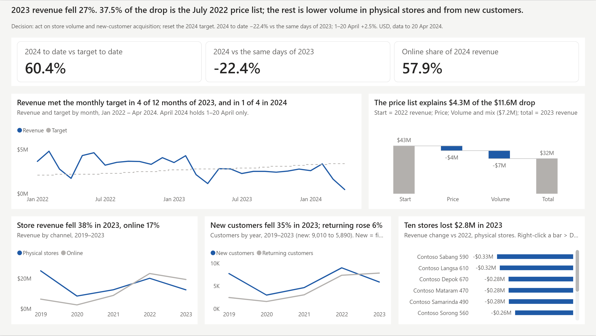
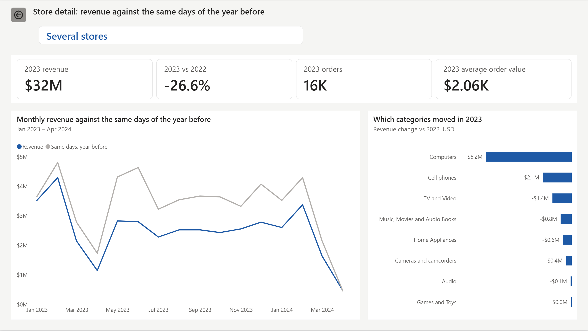

# Measures for the final dashboard

Copy one block at a time. In Power BI Desktop: select **Metrics**, then **Home > New measure**, paste, press Enter. Then set the format named above the block.

The goal is this page:



## 1. Fix Sales, then the base measures (Day 1, Lab 2)

Do this first. The column `Sales` in FactSales forgot the discount. In Power Query, select **FactSales**, then select the step **Inserted Multiplication** in Applied Steps. In the formula bar, replace the formula with this one and press Enter:

```m
= Table.AddColumn(#"Removed Columns", "Sales", each [Quantity] * [UnitPrice] * (1 - [Disc]), type number)
```

The column `CoGS` (step **Inserted Multiplication1**) is right. Do not change it. Click **Home > Close & Apply**.

Check: `Revenue` is $203,723,866 in total. Every check number in this file assumes this fix.

You already have the base measures. Copy only the ones you miss.

Format: `Revenue`, `Cost`, `Margin`, `Target` as currency with 0 decimals. `Orders`, `Units`, `Customers` as whole number. `AOV` as currency with 2 decimals.

```dax
Revenue = SUM ( FactSales[Sales] )
```

```dax
Cost = SUM ( FactSales[CoGS] )
```

```dax
Margin = [Revenue] - [Cost]
```

```dax
Orders = DISTINCTCOUNT ( FactSales[OrderKey] )
```

```dax
Units = SUM ( FactSales[Quantity] )
```

```dax
AOV = DIVIDE ( [Revenue], [Orders] )
```

```dax
Target = SUM ( FactTarget[Target] )
```

```dax
Customers = DISTINCTCOUNT ( FactSales[CustomerKey] )
```

## 2. Target and last year, cut at the last sales date

Sales stop on 20 April 2024. These measures need the column `DimDate[IsPastSales]` from Lab 2.

Format: `Target to Date`, `Revenue PY`, `Revenue PY to Date`, `Revenue Change vs PY` as currency with 0 decimals. `Achievement %` and `YoY %` as percentage with 1 decimal.

```dax
Target to Date =
CALCULATE ( [Target], DimDate[IsPastSales] = TRUE () )
```

`Achievement %` exists already. Open it and replace its formula with this one:

```dax
Achievement % = DIVIDE ( [Revenue], [Target to Date] )
```

```dax
Revenue PY =
CALCULATE ( [Revenue], SAMEPERIODLASTYEAR ( DimDate[Date] ) )
```

```dax
Revenue PY to Date =
CALCULATE ( [Revenue PY], DimDate[IsPastSales] = TRUE () )
```

```dax
YoY % =
VAR PY = [Revenue PY to Date]
RETURN DIVIDE ( [Revenue] - PY, PY )
```

```dax
Revenue Change vs PY = [Revenue] - [Revenue PY to Date]
```

Check: with Year = 2024, `Achievement %` is 60.4% and `YoY %` is -22.4%.

## 3. Online against physical stores

First take the online store out of Banten. In Power Query, select **DimStore**, click **fx** in the formula bar, and paste this step. Replace `#"Added Custom"` with the name of your last step.

```m
= Table.ReplaceValue(
    #"Added Custom",
    each [Province],
    each if [Channel] = "Online" then "Online" else [Province],
    Replacer.ReplaceValue,
    {"Province"}
)
```

Format: `Online Revenue` and `Store Revenue` as currency with 0 decimals. `Online Share` as percentage with 1 decimal.

```dax
Online Revenue =
CALCULATE ( [Revenue], KEEPFILTERS ( DimStore[Channel] = "Online" ) )
```

```dax
Store Revenue =
CALCULATE ( [Revenue], KEEPFILTERS ( DimStore[Channel] = "Offline" ) )
```

```dax
Online Share = DIVIDE ( [Online Revenue], [Revenue] )
```

Check: with Year = 2024, `Online Share` is 57.9%.

## 4. New and returning customers

Format: whole number.

```dax
New Customers =
VAR _PeriodStart = MIN ( DimDate[Date] )
VAR _CustomersInPeriod = VALUES ( FactSales[CustomerKey] )
VAR _EarlierCustomers =
    CALCULATETABLE (
        VALUES ( FactSales[CustomerKey] ),
        REMOVEFILTERS ( FactSales ),
        DimDate[Date] < _PeriodStart
    )
RETURN
    COUNTROWS ( EXCEPT ( _CustomersInPeriod, _EarlierCustomers ) )
```

```dax
Returning Customers = [Customers] - [New Customers]
```

Check: `New Customers` is 9,010 in 2022 and 5,890 in 2023.

## 5. Price and volume bridge

First make the table for the axis: **Home > Enter data**, name it `Bridge`, with these rows. Then select the column `Step` and choose **Sort by column > Order**.

| Step | Order |
|---|---|
| Start | 1 |
| Price | 2 |
| Volume | 3 |

Format: currency with 0 decimals.

This is the case where SUMX is needed. `Sales` and `CoGS` are Power Query columns because both factors are already in FactSales. The list price is in DimProduct, so SUMX reads it for each sales line through RELATED, and the price is not copied into the fact table.

```dax
Revenue at List Price =
SUMX (
    FactSales,
    FactSales[Quantity] * RELATED ( DimProduct[Price] )
        * ( 1 - FactSales[Disc] )
)
```

```dax
Bridge Value =
VAR ListNow = [Revenue at List Price]
VAR ListPY =
    CALCULATE ( [Revenue at List Price], SAMEPERIODLASTYEAR ( DimDate[Date] ) )
RETURN
    SWITCH (
        SELECTEDVALUE ( Bridge[Step] ),
        "Start", [Revenue PY],
        "Volume", ListNow - ListPY,
        "Price", ( [Revenue] - ListNow ) - ( [Revenue PY] - ListPY ),
        [Revenue]
    )
```

Check: with Year = 2023, Start is $43,426,104, Price is -$4,329,582, Volume is -$7,225,290 and the total is $31,871,231.

## 6. Stores with the largest drop

Format: `Store Decline Rank` as whole number.

```dax
Store Decline Rank =
IF (
    ISINSCOPE ( DimStore[StoreName] ),
    RANKX (
        ALLSELECTED ( DimStore[StoreName] ),
        [Revenue Change vs PY], , ASC, DENSE
    )
)
```

```dax
Selected Store = SELECTEDVALUE ( DimStore[StoreName], "Several stores" )
```

## 7. The visuals on the page

| Visual | Fields | Filters on the visual |
|---|---|---|
| Card (new) with three values | `Achievement %`, `YoY %`, `Online Share` | Year = 2024 |
| Line chart: revenue against target | X-axis `DimDate[MonthStart]`. Y-axis `Revenue`, `Target` | Year = 2022, 2023, 2024. IsPastSales = True |
| Waterfall chart: bridge | Category `Bridge[Step]`. Y-axis `Bridge Value` | Year = 2023 |
| Line chart: channel | X-axis `DimDate[Year]`. Y-axis `Store Revenue`, `Online Revenue` | Year = 2019 to 2023 |
| Line chart: customers | X-axis `DimDate[Year]`. Y-axis `New Customers`, `Returning Customers` | Year = 2019 to 2023 |
| Bar chart: ten stores | Y-axis `DimStore[StoreName]`. X-axis `Revenue Change vs PY` | Year = 2023. Channel = Offline. `Store Decline Rank` is less than or equal to 10 |

## 8. The drill-through page



The bar chart on this page needs `DimProduct[CategoryName]`. In Power Query, select **DimProduct**, then select the step **Removed Columns** in Applied Steps. In the formula bar, replace the formula with this one, which keeps `CategoryName`, and press Enter. Then click **Home > Close & Apply**.

```m
= Table.RemoveColumns(#"Renamed Columns", {"Brand", "SubCategoryName", "Weight", "WeightUnit"})
```

Add a page named `Store detail` and put `DimStore[StoreName]` in **Drill through** in the Build pane. Power BI adds the back button.

| Visual | Fields | Filters on the visual |
|---|---|---|
| Card: store name | `Selected Store` | |
| Card (new) with four values | `Revenue`, `YoY %`, `Orders`, `AOV` | Year = 2023 |
| Line chart | X-axis `DimDate[MonthStart]`. Y-axis `Revenue`, `Revenue PY to Date` | Year = 2023, 2024. IsPastSales = True |
| Bar chart | Y-axis `DimProduct[CategoryName]`. X-axis `Revenue Change vs PY` | Year = 2023 |

To use it: on the first page, right-click a bar of the ten-stores chart, then **Drill through > Store detail**.
